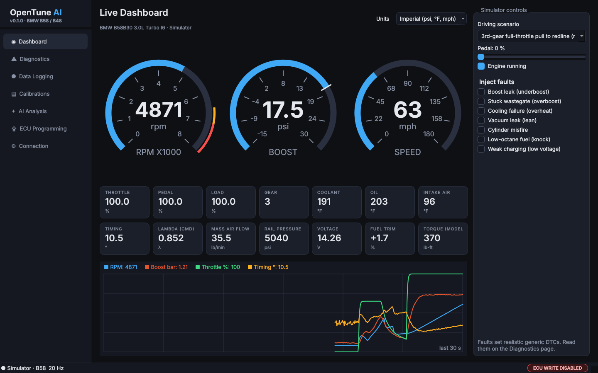

# OpenTune AI

**Subscription-free BMW diagnostics and ECU-tuning development platform.**
Starts with the **B58** (3.0 L turbo I6) and **B48** (2.0 L turbo I4). Built with
Python + PySide6, macOS first.



> **Version 0.1 is simulation-first.** Every feature works against a built-in engine
> simulator. Real cars can be read (live data, trouble codes, VIN) through a
> standard ELM327-compatible adapter. **Writing to a real ECU is disabled in code**
> and cannot be switched on by any setting.

## Features (v0.1)

| Area | What you get |
|---|---|
| **Dashboard** | Dark-themed live gauges (RPM, boost with target marker, speed), 14 readouts, 30-second strip chart, metric/imperial units |
| **Simulator** | B58/B48 engine + 8-speed car model: turbo spool, boost taper, ignition, enrichment, heat soak, shifting. Scenarios: idle, city, cruise, 3rd-gear pulls, track. Inject faults (boost leak, stuck wastegate, overheat, vacuum leak, misfire, knock, weak charging) |
| **OBD-II diagnostics** | Modular stack: SAE J1979 PID decoders, ELM327 protocol layer (multi-frame aware), pyserial transport, and an ELM327 emulator so the real code path is testable without a car |
| **Trouble codes** | Stored, pending and permanent DTCs, MIL status, clear (with confirmation), VIN. Generic SAE descriptions only — manufacturer codes are never guessed |
| **Data logging** | One-click CSV recording of every channel (`*.otlog.csv`) with metadata; opens in Excel/Numbers/pandas |
| **Calibration files** | Content-addressed library with SHA-256 integrity, lineage, byte-level compare, export. Map editor for the simulator's own (fictional) OTSIM calibrations |
| **AI analysis** | Offline rule engine: pull detection, power estimate, under/overboost, possible knock, heat soak, fuel trims, voltage, rough idle → health score + Markdown report. Optional plain-language narrative from a **local** model (Ollama or any OpenAI-compatible local server) |
| **ECU programming (simulated)** | Full workflow against a simulated ECU: safety gate → validation → preflight (voltage, engine off) → automatic backup → transfer → verify → recovery after a simulated power loss |
| **CLI / cloud mode** | `opentune simulate`, `dtc`, `scan`, `analyze`, `cal`, `flash-sim`, `selftest` — no display needed |

No account. No subscription. No cloud services required.

## Quick start (macOS)

Full instructions: [docs/INSTALL_MACOS.md](docs/INSTALL_MACOS.md).

```bash
git clone https://github.com/pbelfand-dot/OpenTune-AI..git OpenTune-AI
cd OpenTune-AI
./scripts/setup_macos.sh          # creates .venv and installs everything
source .venv/bin/activate
opentune-gui                      # launch the desktop app
```

## Command line (works anywhere, including headless cloud machines)

```bash
opentune info                                               # versions, safety status, engine specs
opentune selftest                                           # end-to-end check, no car needed
opentune simulate --engine B58 --scenario wot_pull --duration 20
opentune simulate --engine B48 --fault boost_leak --log pull.otlog.csv
opentune simulate --via-obd --units imperial                # through the ELM327 emulator
opentune analyze pull.otlog.csv                             # rule-based report
opentune analyze pull.otlog.csv --local-model ollama:llama3.2
opentune dtc --fault overheat --scenario cruise --run-seconds 90 --clear
opentune cal new-stock --engine B58 && opentune cal list
opentune flash-sim --engine B58 --power-loss 40 --recover   # simulated ECU only
opentune scan --list-ports                                  # real adapter (read-only)
opentune scan --port /dev/cu.usbserial-XXXX
```

## Development

```bash
python3 -m venv .venv && source .venv/bin/activate
pip install -e ".[dev]"
ruff check src tests
pytest -q            # ~255 tests, including headless GUI tests
```

Architecture, rules and conventions for contributors (human or AI) are in
[CLAUDE.md](CLAUDE.md). Verified reference facts and their sources are in
[docs/RESEARCH.md](docs/RESEARCH.md).

## Safety and legal

- OpenTune AI v0.1 **cannot write to a real ECU**. The simulated programming
  environment exists to develop and test the workflow safely.
- Clearing DTCs on a real car also resets emissions readiness monitors.
- Modifying engine calibrations can damage engines and may violate emissions laws
  (e.g. the US Clean Air Act tampering provisions). See [docs/RESEARCH.md](docs/RESEARCH.md).
- OpenTune AI is not affiliated with BMW AG, Toyota, MHD, bootmod3 or any adapter maker.
