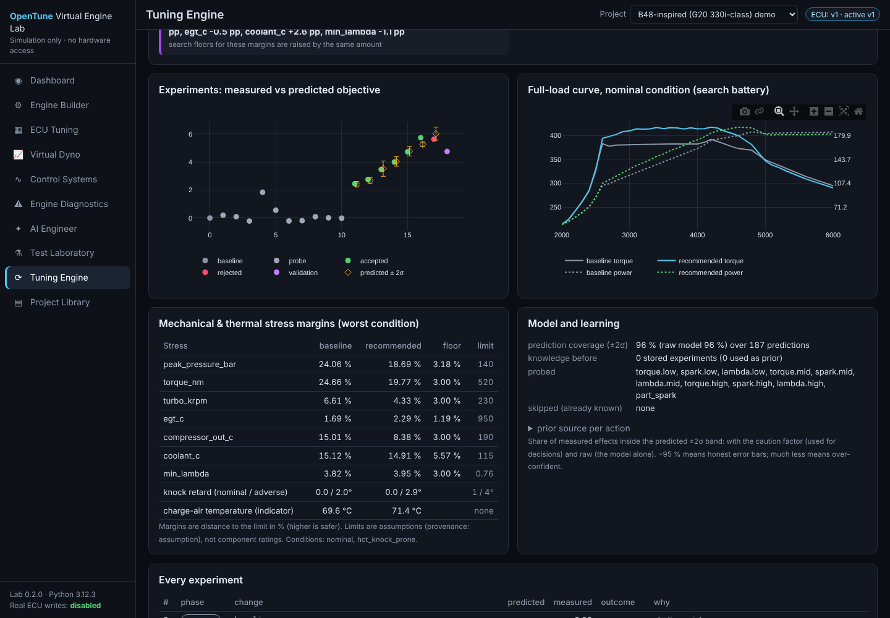

# Tuning engine

The Virtual Engine Lab exists to **train, test, validate and continuously improve OpenTune's
calibration recommendations**. The tuning engine (`src/opentune/lab/tuning/`) is the part that
does the tuning: it experiments with calibration changes on the simulator, measures what they do to
performance, efficiency and mechanical stress, notices its own mistakes, and gets better as its
experience grows.

> Everything below runs on a synthetic engine model. A recommendation from the tuning engine is
> an input for further simulation and, eventually, supervised measurement by qualified people —
> **never a calibration for a vehicle and never evidence that one is safe.** Every report carries
> `ready_for_vehicle: false`, and nothing in the tuning package can reach flashing, programming,
> OBD or serial code (a test checks the imports).



## The loop

```
             ┌──────────────── knowledge base (every experiment, mistakes, benchmarks) ──────────────┐
             │                                                                                        │
baseline ─► diagnose ─► probe (only what is still unknown) ─► propose ─► predict ± σ ─► safety screen ─►
             test on the battery ─► judge vs limits and baseline ─► accept / reject ─► learn ─► … ─► validate
```

1. **Baseline and diagnosis** — the starting calibration is run on the *search battery* and on the
   larger *validation battery*. The diagnosis lists binding constraints (tight stress margins, knock
   control, exhaust-temperature protection), where torque is air-limited, and how much harsher the
   validation battery is than the search battery.
2. **Repair (only if needed)** — if the starting calibration already breaks a limit on this engine
   model, the tuner first looks for the smallest changes that restore every limit with a little
   clearance, while screening every other margin. If it cannot, it recommends **nothing** and says
   how far it got.
3. **Probes** — one step per action in the direction expected to help, but only where the response
   model is still uncertain. Knowledge from earlier sessions removes probes.
4. **Propose** — single steps and pairs inside a per-action trust region, including *trades*: a move
   that helps the goal combined with one that relieves the tightest margin (e.g. less top-end torque
   to make room for more mid-range torque).
5. **Predict** — the response model gives each output's expected change and standard deviation.
6. **Safety screen** — a proposal is tested only if every stress margin is predicted to stay above
   its floor with `mean − k·σ` (k = 2 by default) and knock control is predicted not to grow.
7. **Test and judge** — the battery is run; the candidate must have no violation, every margin
   above its floor, and no more than 1° extra knock retard in adverse conditions.
8. **Accept or reject** — accepted only if it passes and really improves the goal; the trust region
   grows after a success and shrinks after a failure. Every result updates the model.
9. **Learn from mistakes** — a *constraint surprise* (predicted safe, failed), a *validation failure*,
   a *regression* (predicted gain, measured loss) or a large *prediction miss* is logged. Prediction
   errors feed caution factors that widen future error bars; actions with surprises start later
   sessions with a smaller trust region.
10. **Validate** — the final candidate runs the larger battery. If it fails, the tuner walks back to
    the last accepted step that passes.

## The test battery and stress

| Battery | Conditions | Extra |
|---|---|---|
| quick (search) | nominal 25 °C; hot + knock-prone engine | 3 part-load points |
| standard (validation) | nominal; hot 35 °C / 60 % airflow; fuel −2 AKI; knock-prone; weak turbo | 4 part-load points, tip-in |
| thorough | + hot-exhaust engine, hot + knock-prone | 5 part-load points, tip-in |

*Knock-prone*, *hot-exhaust* and *weak-turbo* are **perturbed engine models** (knock limit −2°,
wall heat −10 % and charge cooling −8 %, compressor/turbine efficiency −3/−4 points): the
calibration must hold up if the model's assumptions are somewhat wrong.

**Metrics** (nominal condition): top-end power (mean of the last 1500 rpm — a single peak jumps by
±1 % when it moves between rpm bins), mean power, mean torque, part-load BSFC **at equal torque**
(at equal pedal a higher torque limit would look "more efficient"), tip-in response.

**Stress** (worst condition), each with a limit and a margin: peak cylinder pressure, crank torque
(130 % of the published rated torque — a stand-in for drivetrain and connecting-rod strength),
turbo speed, pre-turbine exhaust temperature, compressor-outlet temperature, coolant temperature,
minimum lambda, plus knock retard (nominal ≤ 1°, adverse ≤ 4°) and any DTC or protection mode.
Charge-air temperature is reported as an **indicator** without a limit by default: its real risk is
knock, which the hot and knock-prone conditions test directly (set `max_iat_c` to make it a hard
limit). All limits are assumptions, not component ratings, and can be changed per session.

Margins must stay above **3 %**. Where the baseline is already tighter (e.g. exhaust temperature held
near its limit by protection enrichment on a hot day), a candidate may not make it worse by more
than 0.5 percentage points. Floors are raised by the gap measured between the search and validation
batteries on the baseline, which removes most validation failures before they happen.

## Actions

A small vocabulary of bounded, composite changes, applied as offsets from the baseline (so every
candidate is `baseline + offsets` — reproducible and explainable):

| Action | Step | Range | What changes |
|---|---|---|---|
| `torque.low / mid / high` | 3 % | −30 … +15 % | torque limit in the rpm zone **and** the high-pedal boost cap with it |
| `spark.low / mid / high` | 1° | −4 … +3° | base ignition at ≥ 120 % load (half at 100 %) |
| `lambda.low / mid / high` | 0.02 | ±0.06 | full-load lambda target; never leaner than stoichiometric where enriched |
| `part_spark` | 1° | ±3° | base ignition at 30–90 % load |

Zones: low 1250–2500 rpm, mid 3000–4500 rpm, high ≥ 5000 rpm. Not offered: part-load lambda
(emissions and catalyst efficiency are not modelled), idle/cold-start/protection tables (safety
functions are not tuning targets), and the ECU torque model.

## Response model and learning

For every output (metric % change, stress-margin change in percentage points, knock change in
degrees) a **quadratic response surface** over the action offsets, fitted by Bayesian linear
regression:

* **prior** — earlier experiments on the same engine model, else the same family, else any engine
  (each with wider uncertainty), else a weak *engineering prior* (directional rules of thumb,
  labelled as assumptions); slope and curvature of one action keep their correlation when knowledge
  is carried between sessions;
* **locality** — experiments far from the current point count less;
* **anchored predictions** — a prediction is the change from a *measured* calibration, so bias at
  that point cancels;
* **linear extrapolation** — outside the explored range the surface continues along its tangent,
  so a fitted parabola cannot "turn around" (e.g. claim that cutting more torque heats the exhaust);
* **caution factors** — the RMS of past prediction z-scores per output; if the model has been
  over-confident, its error bars are widened (up to 4×).

Why not a neural network or reinforcement learning? Each experiment costs about a second of
simulation; a physics-informed surrogate learns from tens of experiments rather than tens of
thousands, gives calibrated error bars that the safety screen can use, and every decision can be
explained ("predicted +0.41 ± 0.09, measured +0.40, all margins above their floors").

## Benchmark and training

`run_benchmark` scores the tuner on a fixed task suite and stores the result with the size of the
knowledge base; `train` runs a curriculum on the nominal presets. Benchmarks include **held-out
engines** — presets with assumption parameters perturbed by seeded ~1σ draws (and different fuel in
the standard suite) — which training never sees. Scores: validated gain, simulations per task,
constraint surprises, validation failures, prediction coverage (share of measured effects inside
±2σ; ~95 % is honest).

### Results on this repository's models (quick suite)

Measured on 2026-10-14 with tuner 1.0 (4-core container; one benchmark ≈ 2 min, one training round
≈ 2 min). Gains are the goal's weighted % improvement after validation.

Three benchmarks of the same suite (knowledge base read-only during each), with one training
round of the curriculum (6 sessions on the nominal presets) between them:

| Stored experiments before the benchmark | 0 | 79 | 122 |
|---|---|---|---|
| B58-inspired · top-end power: validated gain (simulations) | +4.40 (20) | +3.01 (6) | +4.97 (11) |
| B48-inspired · mid-range torque | +4.75 (20) | +4.73 (12) | +5.60 (8) |
| held-out B58 variant · balanced (stock exceeds EGT limit → repaired) | −2.36 (21) | −3.67 (32) | **+0.57** (24) |
| held-out B48 variant · top-end power (stock 49 °C over the EGT limit) | not repairable (19) | not repairable (22) | not repairable (21) |
| gain per 100 simulations | 8.5 | 5.7 | **17.4** |
| mean simulations per task | 20.0 | 18.0 | 16.0 |
| constraint surprises / validation failures | 0 / 0 | 0 / 0 | 0 / 0 |
| prediction coverage (±2σ, with caution factor) | 0.95 | 0.93 | 0.91 |

Training sessions themselves: round 1 used 14.2 simulations per task (gain per 100 simulations
30.3), round 2 used 8.2 (54.2), all validated, no surprises.

What this shows, and what it does not:

* On the nominal presets the tuner finds validated improvements with **no constraint surprises and
  no validation failures** in any run.
* Knowledge **replaces experiments**: after training, sessions skip their probes; efficiency (gain
  per simulation) doubled between the untrained and the twice-trained tuner, and the repaired
  held-out engine went from a net loss to a net gain.
* Improvement is **not monotonic**: after one round the B58 task stopped early at a lower optimum
  (path dependence of a local search). Two rounds were better on every task.
* Prediction coverage drifted from 0.95 to 0.91 as knowledge accumulated — slightly over-confident.
  The caution factors and the 2σ safety screen absorbed it here (no surprises), but it is the
  first thing to watch; widening the same-engine transfer variance is the obvious fix.
* On held-out engines the generated stock calibration already exceeded the exhaust-temperature
  limit in hot conditions. The tuner detected it, repaired one engine (at a cost in top-end power —
  the honest price of getting back within limits) and declined to recommend anything for the other,
  where the remaining excess could only be fixed outside its remit (protection tables or hardware).
* None of this says anything about a real engine.

## Using it

* **UI:** *Tuning Engine* page — start a session from any calibration of the project, read the
  diagnosis, every experiment (predicted vs measured), the stress margins and the validation; apply
  the recommendation to the working copy (undoable) and verify it on the dyno and in the Test
  Laboratory. Tabs for what the tuner has learned (sensitivities ± σ, caution factors, mistakes)
  and for benchmark/training history.
* **CLI:** `opentune-lab tune --engine b48-inspired --goal midrange_torque --budget 12`,
  `opentune-lab train --rounds 1`, `opentune-lab benchmark --suite quick`.
* **API:** `/api/tuning/meta`, `POST /api/tuning/sessions`, `GET /api/tuning/sessions/{id}`,
  `POST /api/projects/{pid}/tuning/apply`, `/api/tuning/knowledge`, `/api/tuning/mistakes`,
  `POST /api/tuning/benchmark`, `POST /api/tuning/train`, `/api/tuning/benchmarks`.
* **Python:** `TuningSession(config, calibration, TuningRequest(...), KnowledgeBase(path)).run()`.

The knowledge base is `<data dir>/lab/tuning.sqlite`.

## Limitations

* The tuner is only as good as the model it experiments on. Every learned sensitivity describes the
  synthetic model; transfer to a real engine is unknown until measured.
* Ten actions over four tables; no transient, cold-start, emissions or durability optimisation.
* The response model is quadratic per action without interactions; pairs are proposed but their
  interaction is not modelled.
* Validation uses more conditions and perturbed engines, but the same model family — a calibration
  that passes may still fail on hardware for reasons the model does not contain.

## Towards real-world measurements

The same loop is designed to take measured data later (roadmap M8): measured logs labelled
`measured` would update the response model (with their own noise), identify model parameters,
and shrink the uncertainty that the safety screen uses. Real-car access remains read-only.
